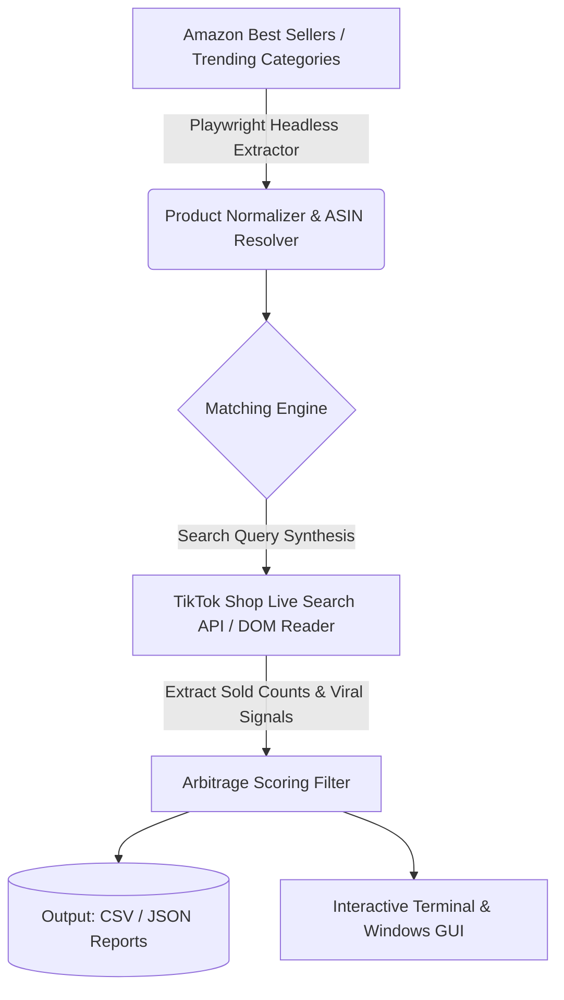

# 🛍️ TikTok Product Hunter

<div align="center">

[](LICENSE)
[](https://github.com/Kamran5H/TikTokProductHunter)
[](https://playwright.dev/)
[](https://github.com/Kamran5H/TikTokProductHunter)
[](https://github.com/Kamran5H/TikTokProductHunter)

**High-velocity automated product discovery engine bridging Amazon bestsellers with TikTok Shop viral traction.**

[Key Features](#-key-features) • [Architecture](#-system-architecture) • [Installation](#-installation) • [Usage](#-usage-guide) • [License](#-license)

</div>

---

## 🌟 Executive Overview

**TikTok Product Hunter** is an enterprise-grade product research automation suite engineered in Python. It systematically scrapes trending and top-selling catalogs on Amazon, extracts verified product titles, brand entities, and ASINs, and cross-references them in real time across **TikTok Shop** to detect viral momentum, pricing spreads, and arbitrage opportunities.

Powered by **Playwright headless/headed automation**, the suite implements browser-fingerprint evasion, realistic human scroll jitter, random delay distributions, and automated session caching to bypass aggressive bot mitigations.

---

## 🚀 Key Features

- **🔄 Cross-Platform Pipeline**: Automatically queries Amazon bestsellers and checks viral velocity across TikTok Shop trending creators and storefronts.
- **🛡️ Advanced Anti-Detection Protocols**: Patched navigator flags (`navigator.webdriver`), randomized viewport dimensions, and human-like cursor movements.
- **📊 Granular Product Extraction**:
  - Amazon Title, ASIN, Price, Rating, and Review Velocity
  - TikTok Shop matching listings, sold units count, and seller ratings
  - Arbitrage spread and estimated gross margin calculation
- **⚡ One-Click Windows Launcher**: Pre-configured `run_tiktok_hunter.bat` for turnkey execution without touching the command line.
- **💾 Structured Data Output**: Exports clean, deduplicated datasets directly into structured JSON and CSV formats for immediate spreadsheet analysis.

---

## 🏗️ System Architecture



---

## 📁 Repository Structure

```text
TikTokProductHunter/
├── tiktok_product_hunter.py    # Primary scraper engine & cross-platform matching pipeline
├── TikTok Shop confirm.py      # Confirmation verifier & detail extraction script
├── run_tiktok_hunter.bat       # Windows turnkey launcher script
├── tiktok_hunter.ico           # Application icon
├── .gitignore                  # Python & Playwright artifacts exclusion rules
└── LICENSE                     # Open-source MIT License
```

---

## ⚡ Installation

### Prerequisites
- Python 3.10 or higher
- Windows 10/11 or modern Linux/macOS

### Setup
```bash
# Clone the repository
git clone https://github.com/Kamran5H/TikTokProductHunter.git
cd TikTokProductHunter

# Create and activate virtual environment
python -m venv .venv
source .venv/bin/activate  # On Windows: .venv\Scripts\activate

# Install dependencies
pip install playwright pandas requests
playwright install chromium
```

---

## 🖥️ Usage Guide

### 1. Interactive Windows Run
Simply double-click [`run_tiktok_hunter.bat`](run_tiktok_hunter.bat) to launch the hunter with default parameters.

### 2. Command-Line Execution
```bash
# Run full discovery pipeline
python tiktok_product_hunter.py

# Verify and validate specific TikTok Shop matches
python "TikTok Shop confirm.py"
```

---

## 📜 License

This project is open-source and released under the [MIT License](LICENSE).  
Copyright (c) 2024-2026 **Kamran Ashraf**.

---

<div align="center">

<a href="https://github.com/Kamran5H">
  
</a>

<br/>

### 👨‍💻 **Developer:** [Kamran Ashraf](https://github.com/Kamran5H)
*AI Systems Architect • Computational Physical Chemist • Automation Pioneer*

[](https://github.com/Kamran5H)
[](https://kamranashraf.is-a.dev)
[](mailto:chkamran32b@gmail.com)

</div>

